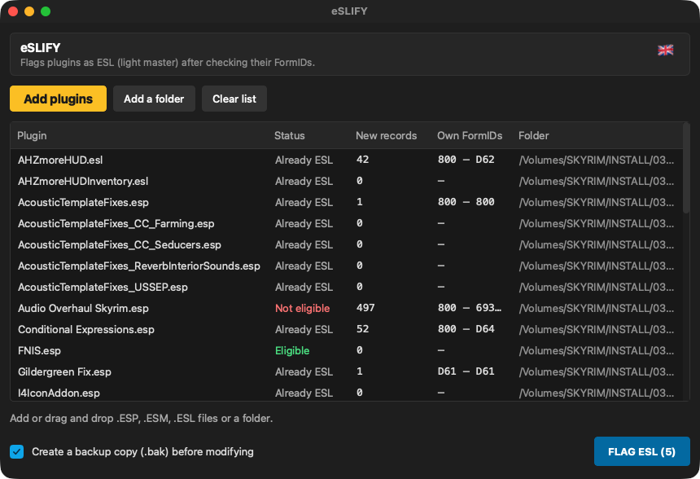

<p align="center"></p>

# eSLIFY

**Flags Skyrim plugins as ESL (light master) — only after checking that it is safe.**  
*Marque les plugins Skyrim comme ESL (light master) — seulement après avoir vérifié que c'est sans risque.*

🇬🇧 [English](#-english) · 🇫🇷 [Français](#-français)

---
## 🇬🇧 English

### What it does

Light plugins (ESL-flagged) don't count toward the 254-plugin limit. But flagging a plugin whose own FormIDs don't fit the light range breaks it. eSLIFY checks each plugin first (own FormIDs within 0x800–0xFFF, header version) and only flags the eligible ones, with a backup.

### Features

- Add plugins or whole folders (drag and drop supported).
- For each plugin: status (eligible, not eligible, already ESL), number of new records, range of own FormIDs.
- Clear reason when a plugin is not eligible (FormIDs to compact in xEdit, header 1.71 needed…).
- Flags the eligible plugins of the selection (or the whole list) in one click.
- Optional **.bak backup** of each file before modification.
- Interface in **English, French, Italian and Spanish** (follows your Mac's language; can be changed in the app).

### What's new in 1.3.0

- Signed with a Developer ID and notarized by Apple: macOS now opens the app without a security warning.
- The app's launcher is now compiled from source when the app is built, instead of using PyInstaller's generic prebuilt launcher, which antivirus scanners tend to flag. No change in features.
- The first letter of the app's name now uses the colour of its logo everywhere it appears.
- Version number aligned across the Skyrim Mac Toolkit.

### Updates

The app checks once a day whether a newer release exists on GitHub and offers to open the Nexus page, remind you later or skip that version. Nothing is downloaded or installed automatically. The full history is in [CHANGELOG.md](CHANGELOG.md).

### Screenshots


*Eligibility check of a whole Data folder*

### Requirements

A Mac with **Apple Silicon** (M1 or later), **macOS 13 Ventura** or later. No Python, no Wine, no virtual machine needed.

### Installation

1. Download the zip from Nexus Mods (or from the GitHub releases) and unzip it.
2. Move **eSLIFY.app** to your **Applications** folder.

### How to use

1. Click **Add plugins** or **Add a folder** (or drop files on the window).
2. Read the status of each plugin; select one to see the detailed reason.
3. Keep **Create a backup copy** checked and click **FLAG ESL (n)**.

### FAQ

**A plugin is "Not eligible".**  
Its own FormIDs are too high: compact them in xEdit first (Compact FormIDs for ESL), then try again.

### Building from source

Requires Python 3.12 with PyQt6 and PyInstaller. From the repository folder:

```bash
./build_app.sh
```

### License

Released under the **MIT License**: free to use, modify and share. Part of the **Skyrim Mac Toolkit**, a set of modding tools built for Skyrim players on Mac.

---

## 🇫🇷 Français

### À quoi ça sert

Les plugins légers (drapeau ESL) ne comptent pas dans la limite de 254 plugins. Mais marquer un plugin dont les FormID propres sortent de la plage légère le casse. eSLIFY vérifie d'abord chaque plugin (FormID propres entre 0x800 et 0xFFF, version d'en-tête) et ne marque que les plugins éligibles, avec une sauvegarde.

### Fonctions

- Ajoutez des plugins ou des dossiers entiers (glisser-déposer accepté).
- Pour chaque plugin : statut (éligible, non éligible, déjà ESL), nombre de nouveaux enregistrements, plage des FormID propres.
- Raison claire quand un plugin n'est pas éligible (FormID à compacter dans xEdit, en-tête 1.71 nécessaire…).
- Marque en un clic les plugins éligibles de la sélection (ou de toute la liste).
- **Sauvegarde .bak** facultative de chaque fichier avant modification.
- Interface en **français, anglais, italien et espagnol** (suit la langue du Mac ; modifiable dans l'appli).

### Nouveautés de la 1.3.0

- Signée avec un certificat Developer ID et notarisée par Apple : macOS ouvre désormais l'appli sans avertissement de sécurité.
- Le lanceur de l'appli est maintenant compilé depuis les sources à la construction de l'appli, au lieu du lanceur générique précompilé de PyInstaller, souvent signalé par les antivirus. Aucun changement de fonctionnalités.
- La première lettre du nom de l'appli prend la couleur de son logo partout où il est écrit.
- Numéro de version commun à tout le Skyrim Mac Toolkit.

### Mises à jour

L'appli vérifie une fois par jour si une version plus récente existe sur GitHub et propose d'ouvrir la page Nexus, de rappeler plus tard ou d'ignorer cette version. Rien n'est téléchargé ni installé automatiquement. L'historique complet est dans [CHANGELOG.md](CHANGELOG.md).

### Captures d'écran


*Vérification de l'éligibilité de tout un dossier Data*

### Configuration requise

Un Mac **Apple Silicon** (M1 ou plus récent), **macOS 13 Ventura** ou plus récent. Ni Python, ni Wine, ni machine virtuelle.

### Installation

1. Téléchargez le zip sur Nexus Mods (ou dans les releases GitHub) et décompressez-le.
2. Placez **eSLIFY.app** dans votre dossier **Applications**.

### Utilisation

1. Cliquez sur **Ajouter des plugins** ou **Ajouter un dossier** (ou déposez les fichiers sur la fenêtre).
2. Lisez le statut de chaque plugin ; sélectionnez-en un pour voir la raison détaillée.
3. Laissez **Créer une copie de sauvegarde** coché et cliquez sur **MARQUER ESL (n)**.

### Questions fréquentes

**Un plugin est « Non éligible ».**  
Ses FormID propres sont trop élevés : compactez-les d'abord dans xEdit (Compact FormIDs for ESL), puis recommencez.

### Compiler depuis les sources

Nécessite Python 3.12 avec PyQt6 et PyInstaller. Depuis le dossier du dépôt :

```bash
./build_app.sh
```

### Licence

Publié sous **licence MIT** : libre d'utilisation, de modification et de partage. Fait partie du **Skyrim Mac Toolkit**, un ensemble d'outils de modding pensés pour les joueurs de Skyrim sur Mac.
